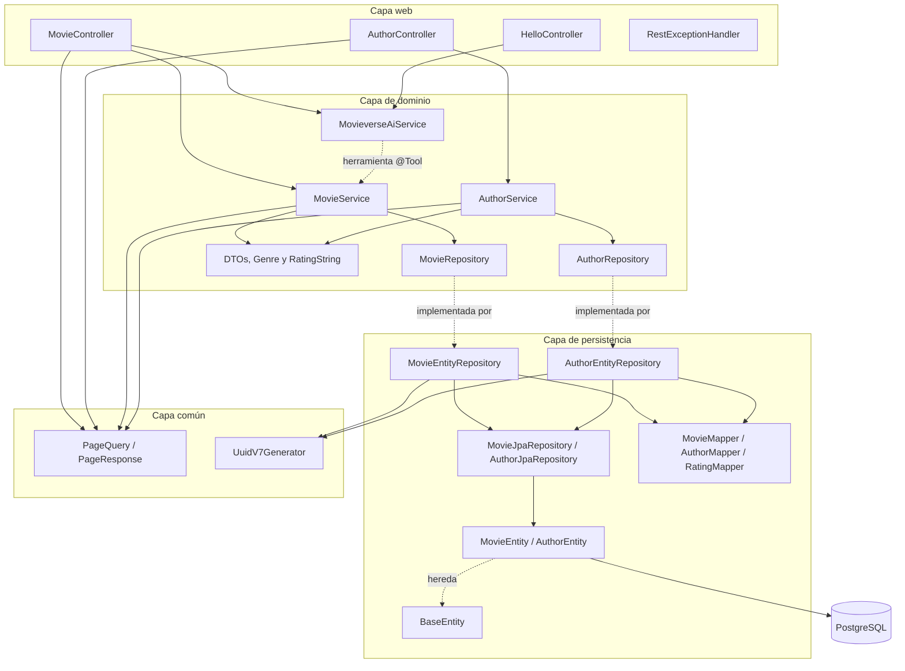
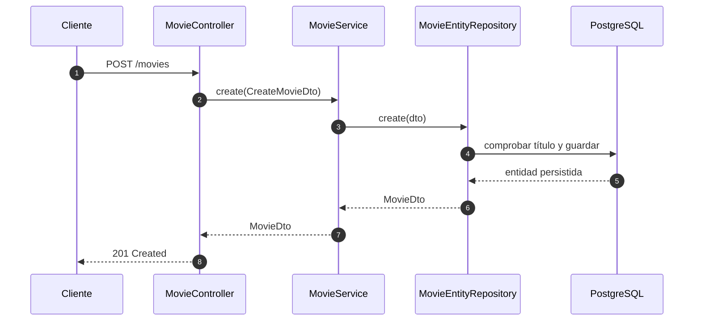
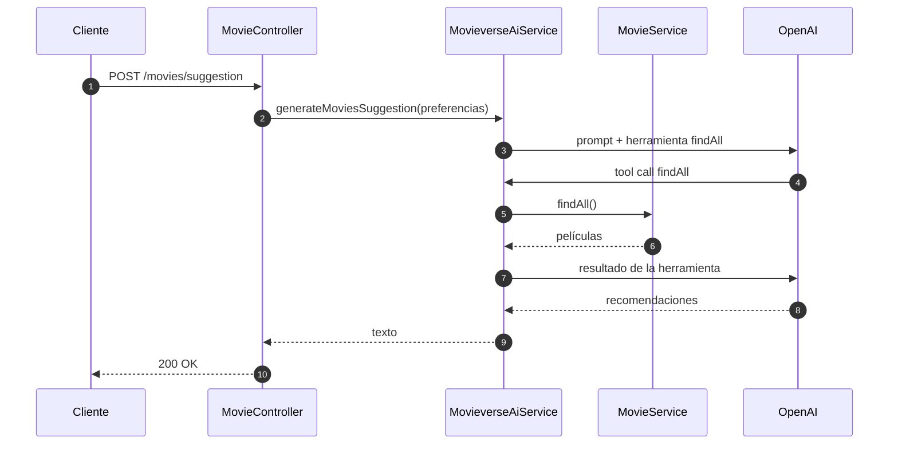

# Arquitectura — Movieverse API

Documento técnico de la API. Para instalación, ejecución y configuración, consulta el [README.md](README.md). Instrucciones para agentes: [AGENTS.md](AGENTS.md).

## Principios

- **Arquitectura hexagonal:** el dominio define contratos y la persistencia los implementa.
- **Separación de capas:** `web` gestiona HTTP, `domain` contiene servicios y contratos, `persistence` implementa el acceso a datos.
- **Dominio independiente:** `domain/` no debe importar clases de `persistence/` ni de `web/`.
- **DTOs como `record`:** los contratos de entrada y salida son inmutables.
- **Mapeo con MapStruct:** las entidades JPA no se exponen directamente en la API.

## Vista de capas



## Estructura de paquetes

```text
src/main/java/com/afperdomo2/movieverse/
├── MovieverseApplication.java
├── common/
│   ├── pagination/
│   │   ├── PageQuery.java
│   │   └── PageResponse.java
│   └── uuid/
│       └── UuidV7Generator.java
├── config/
│   ├── AiHttpConfig.java
│   └── JpaAuditingConfig.java
├── domain/
│   ├── Genre.java
│   ├── RatingString.java
│   ├── dto/
│   │   ├── ai/
│   │   │   └── SuggestionRequestDto.java
│   │   ├── author/
│   │   │   ├── AuthorDetailDto.java
│   │   │   ├── AuthorDto.java
│   │   │   ├── AuthorSummaryDto.java
│   │   │   ├── CreateAuthorDto.java
│   │   │   ├── PatchAuthorDto.java
│   │   │   └── UpdateAuthorDto.java
│   │   └── movie/
│   │       ├── CreateMovieDto.java
│   │       ├── MovieDto.java
│   │       ├── MovieSummaryDto.java
│   │       ├── PatchMovieDto.java
│   │       └── UpdateMovieDto.java
│   ├── exception/
│   │   ├── AuthorAlreadyExistsException.java
│   │   ├── AuthorNotFoundException.java
│   │   ├── MovieAlreadyExistsException.java
│   │   └── MovieNotFoundException.java
│   ├── repository/
│   │   ├── AuthorRepository.java
│   │   └── MovieRepository.java
│   └── service/
│       ├── AuthorService.java
│       ├── MovieService.java
│       └── MovieverseAiService.java
├── persistence/
│   ├── converter/GenreConverter.java
│   ├── entity/
│   │   ├── AuthorEntity.java
│   │   ├── BaseEntity.java
│   │   └── MovieEntity.java
│   ├── jpa/
│   │   ├── AuthorJpaRepository.java
│   │   └── MovieJpaRepository.java
│   ├── mapper/
│   │   ├── AuthorMapper.java
│   │   ├── MovieMapper.java
│   │   └── RatingMapper.java
│   └── repository/
│       ├── AuthorEntityRepository.java
│       └── MovieEntityRepository.java
└── web/
    ├── controller/
    │   ├── AuthorController.java
    │   ├── HelloController.java
    │   └── MovieController.java
    └── exception/
        ├── Error.java
        └── RestExceptionHandler.java
```

## Flujo de una petición CRUD



`MovieService` depende de la interfaz `MovieRepository`; Spring inyecta `MovieEntityRepository`, que es la implementación de persistencia. El CRUD de autores repite exactamente el mismo flujo: `AuthorController` → `AuthorService` → `AuthorRepository` ← `AuthorEntityRepository`.

### Identificadores UUID v7

`MovieEntity` y `AuthorEntity` usan `UUID` como PK. El valor se genera en la aplicación con `UuidV7Generator.generate()` (`common/uuid`), que delega en `UuidCreator.getTimeOrderedEpoch()` de `uuid-creator`. No se usa `@GeneratedValue` ni una función de PostgreSQL: el tipo `uuid` existe en PostgreSQL 16, pero `uuidv7()` solo está disponible de forma nativa desde PostgreSQL 18.

### Paginación del listado

`GET /movies?page=1&limit=10` usa `PageQuery` (page 1-based, limit entre 1 y 100) desde `common/pagination` y llama a `MovieService.findPage`, que delega en `MovieEntityRepository.findPage`. Este construye `PageRequest.of(page - 1, limit, Sort.by("id").ascending())` y devuelve un `PageResponse<MovieDto>` con `items`, `totalElements`, `totalPages`, `hasNext` y `hasPrevious`.

- Una página fuera de rango devuelve `items` vacío con HTTP 200.
- Parámetros inválidos devuelven HTTP 400.
- `MovieService.findAll()` se mantiene sin paginar porque es la herramienta `@Tool` que usa la IA.
- `GET /authors` reutiliza `PageQuery` y `PageResponse` de `common/pagination`, y ordena por `lastName` y luego por `name`.
- `GET /authors/{id}` devuelve `AuthorDetailDto` con `movies` (`MovieSummaryDto`), ordenadas por `releaseDate DESC, title ASC`. Usa `MovieJpaRepository.findByAuthorId`; son 2 consultas y no hay N+1.

## Componentes principales

| Componente | Responsabilidad |
|---|---|
| `MovieController` | Expone `/movies`, valida la entrada y traduce a códigos HTTP |
| `AuthorController` | Expone `/authors` con CRUD paginado; el detalle incluye la filmografía |
| `HelloController` | Expone `/hello` para probar la integración con IA |
| `MovieService` | Orquesta las operaciones de negocio y expone `findAll` como herramienta de IA |
| `AuthorService` | Orquesta las operaciones de autores y el detalle con películas |
| `MovieRepository` | Contrato de persistencia del dominio |
| `AuthorRepository` | Contrato de persistencia de autores |
| `MovieEntityRepository` | Implementa el contrato usando `MovieJpaRepository` y MapStruct |
| `AuthorEntityRepository` | Implementa el CRUD de autores con `AuthorJpaRepository` y MapStruct |
| `MovieEntity.authors` | Relación `@ManyToMany` LAZY con `@BatchSize(50)` y tabla `movie_authors` |
| `MovieJpaRepository` / `AuthorJpaRepository` | Repositorios Spring Data (`JpaRepository`) en `persistence/jpa` |
| `BaseEntity` | `@MappedSuperclass` con `id` UUID, `version`, `createdAt` y `updatedAt`; base común de las entidades |
| `MovieMapper` / `AuthorMapper` | Convierten entre entidades y DTOs |
| `RatingMapper` | Calcula `ratingString` a partir del rating numérico |
| `UuidV7Generator` | Genera UUID v7 para las PK de `movies` y `authors` |
| `RestExceptionHandler` | Traduce excepciones de dominio a respuestas HTTP |
| `MovieverseAiService` | Clase `@Service` que encapsula un `ChatClient` de Spring AI |
| `AiHttpConfig` | Añade `x-opencode-session` y user agent cuando el base-url es de OpenCode Go |

## Modelo de dominio

| DTO | Uso |
|---|---|
| `MovieDto` | Respuesta completa de una película |
| `CreateMovieDto` | Entrada para crear; incluye validaciones |
| `UpdateMovieDto` | Entrada para actualizar título, fecha y rating |
| `PatchMovieDto` | Entrada para actualizar parcialmente una película; usa `Optional` |
| `AuthorDto` | Respuesta completa de un autor |
| `AuthorSummaryDto` | Resumen de autor incrustado en las respuestas de películas |
| `AuthorDetailDto` | Detalle de autor con su filmografía (`movies`) |
| `MovieSummaryDto` | Resumen de película incrustado en el detalle de un autor |
| `CreateAuthorDto` | Entrada para crear un autor |
| `UpdateAuthorDto` | Entrada para actualizar nombre, apellido, nacionalidad, nacimiento y biografía |
| `PatchAuthorDto` | Entrada para actualizar parcialmente un autor; incluye `isActive` |
| `PageQuery` | Parámetros de paginación `page` (1-based) y `limit` (máximo 100); vive en `common/pagination` |
| `PageResponse<T>` | Respuesta paginada con `items`, página actual y metadatos; vive en `common/pagination` |
| `SuggestionRequestDto` | Preferencias del usuario para generar sugerencias |

### Validaciones de creación

- `title`: obligatorio.
- `duration`: obligatorio y mayor que 0.
- `genre`: obligatorio.
- `releaseDate`: obligatorio y no futuro.
- `rating`: obligatorio, entre 0 y 9.

### Validaciones de autores

- `name`: obligatorio, máximo 100 caracteres.
- `lastName`: obligatorio, máximo 100 caracteres.
- `nationality`: opcional, máximo 100 caracteres.
- `birthDate`: opcional y no futuro.
- `biography`: opcional, máximo 1000 caracteres.
- La combinación `name + lastName` es única; si se repite devuelve `409`.

### Categorías de rating

`RatingMapper` calcula `ratingString` con `floor(rating / 2)`:

| Rango numérico | `RatingString` |
|---|---|
| `>= 8.0` | `VERY_GOOD` |
| `6.0 – 7.99` | `GOOD` |
| `4.0 – 5.99` | `AVERAGE` |
| `2.0 – 3.99` | `BAD` |
| `< 2.0` | `VERY_BAD` |

## Persistencia

La entidad `MovieEntity` se mapea a la tabla `movies`:

| Campo | Tipo | Observación |
|---|---|---|
| `id` | `UUID` | UUID v7 generado en la aplicación |
| `title` | `VARCHAR` | Único y obligatorio |
| `duration` | `INTEGER` | Minutos |
| `genre` | `VARCHAR(50)` | Obligatorio; enum `Genre` con 20 valores |
| `release_date` | `DATE` | Obligatorio |
| `rating` | `DECIMAL(3,2)` | Puede ser nulo |
| `is_active` | `BOOLEAN` | `true` por defecto; editable por PATCH |
| `version` | `BIGINT` | Bloqueo optimista (`@Version`), por defecto `0` |
| `created_at` | `TIMESTAMP WITH TIME ZONE` | Auditoría, no se modifica tras crear |
| `updated_at` | `TIMESTAMP WITH TIME ZONE` | Auditoría, se actualiza en cada cambio |

Reglas relevantes:

- La auditoría usa Spring Data JPA (`@CreatedDate`/`@LastModifiedDate` + `@EnableJpaAuditing`) y se define una sola vez en `BaseEntity`. Las columnas son `NOT NULL DEFAULT now()` para que `ddl-auto=update` pueda añadirlas sobre tablas con datos.
- `version` implementa bloqueo optimista, vive en `BaseEntity` y Hibernate lo incrementa en cada actualización; lanza `OptimisticLockException` si hay conflicto.
- `MovieEntity` y `AuthorEntity` extienden `BaseEntity`. No redeclaran `id`, `version`, `createdAt` ni `updatedAt`.
- La entidad usa Lombok (`@Getter`, `@Setter`, `@NoArgsConstructor`); no se usa `@Data` para evitar `equals`/`hashCode`/`toString` inadecuados en JPA.
- `create` deja `is_active = true` y genera el ID con `UuidV7Generator.generate()`.
- `CreateMovieDto` no acepta `id` ni `isActive`; el género es el enum `Genre`. Valida título ≤ 255 y duración ≤ 600 minutos.
- `update` (PUT) actualiza título, fecha y rating; `releaseDate` es obligatoria y `rating` sigue siendo opcional. No cambia `genre` ni `isActive`.
- `patch` (PATCH) puede actualizar título, fecha, rating, `genre` e `isActive`. Un body vacío devuelve 400; un título duplicado devuelve 409; la operación es `@Transactional`.
- Un género inválido o un body ilegible devuelve 400.
- Un título duplicado lanza `MovieAlreadyExistsException` → HTTP 409.
- Un ID inexistente lanza `MovieNotFoundException` → HTTP 404.
- `data.sql` inserta películas y autores de ejemplo solo si su tabla está vacía. Los seeds usan UUID v7 literales con cast `::uuid`.
- El perfil `dev` usa `spring.jpa.hibernate.ddl-auto=update`; no hay migraciones versionadas.

La entidad `AuthorEntity` se mapea a la tabla `authors`:

| Campo | Tipo | Observación |
|---|---|---|
| `id` | `UUID` | UUID v7 generado en la aplicación |
| `name` | `VARCHAR(100)` | Obligatorio |
| `last_name` | `VARCHAR(100)` | Obligatorio; junto a `name` forma una clave única |
| `nationality` | `VARCHAR(100)` | Opcional |
| `birth_date` | `DATE` | Opcional |
| `biography` | `VARCHAR(1000)` | Opcional |
| `is_active` | `BOOLEAN` | `true` por defecto; editable por PATCH |
| `version` | `BIGINT` | Bloqueo optimista (`@Version`), por defecto `0` |
| `created_at` / `updated_at` | `TIMESTAMP WITH TIME ZONE` | Auditoría |

Reglas de autores:

- `AuthorEntityRepository` valida duplicados de `name + lastName` en `create`, `update` y `patch` → `AuthorAlreadyExistsException` → 409.
- Un ID inexistente lanza `AuthorNotFoundException` → 404.
- `POST` fuerza `is_active = true`; `PUT` no cambia `isActive`; `PATCH` sí puede cambiarlo.
- `DELETE` es un borrado físico. Primero elimina sus filas de `movie_authors` y después el autor; las películas permanecen.

### Relación `movie_authors`

`MovieEntity` es el lado dueño de una relación `@ManyToMany` con `AuthorEntity`:

```text
movies 1 ─── N movie_authors N ─── 1 authors
```

| Columna | Tipo | Observación |
|---|---|---|
| `movie_id` | `UUID` | FK a `movies.id` |
| `author_id` | `UUID` | FK a `authors.id` |

- PK compuesta `(movie_id, author_id)`.
- La colección es `LAZY` y usa `@BatchSize(50)` para evitar N+1 en la paginación.
- `@OrderBy("lastName ASC, name ASC")` ordena los autores.
- `MovieDto.authors` expone `AuthorSummaryDto`, no entidades.
- `DELETE /movies/{id}` elimina primero las filas de `movie_authors` y luego la película.
- `DELETE /authors/{id}` elimina primero sus filas de `movie_authors` y luego el autor.
- `spring.jpa.open-in-view=false`; el mapeo a DTO ocurre dentro de métodos transaccionales.

MapStruct genera las implementaciones al compilar. Si se cambia un mapper y el comportamiento no se actualiza, ejecuta `clean` antes de recompilar.

## Integración con IA

`MovieverseAiService` es una clase `@Service` que construye un `ChatClient` a partir del `ChatClient.Builder` que autoconfigura Spring AI. `MovieService.findAll` está anotado con `@Tool` y se registra en la petición de sugerencias con `.tools(movieService)`, de modo que el modelo puede consultar las películas disponibles.

El base-url y el modelo se resuelven con `OPENAI_BASE_URL` y `OPENAI_MODEL` (por defecto OpenAI y `gpt-4o-mini`). Si el base-url apunta a `opencode.ai`, `AiHttpConfig` añade las cabeceras `x-opencode-session` y `User-Agent` que exige OpenCode Go.



La clave por defecto es `demo`. Los endpoints de IA requieren una clave real en `OPENAI_API_KEY`; el CRUD no depende de la IA.

## Configuración y perfiles

| Perfil | Puerto | Base de datos | Observaciones |
|---|---|---|---|
| `dev` | `8082` | PostgreSQL local en `5434` | `ddl-auto=update`, `data.sql` activo |
| `prod` | `8080` | Base externa | Perfil usado por el contenedor Docker |

La configuración base (`application.properties`) define el puerto `8081`, pero `application-dev.properties` lo sobrescribe a `8082`.

Para producción, configura las credenciales mediante variables de entorno. El archivo `application-prod.properties` contiene configuración de una base externa; no lo uses en local sin revisar esos valores.

## Cómo extender el CRUD

Para añadir un campo o una operación a una entidad existente:

1. Actualiza el DTO correspondiente en `domain/dto/movie` o `domain/dto/author`.
2. Modifica la interfaz `domain/repository/{Movie|Author}Repository`.
3. Implementa el cambio en `persistence/repository/{Movie|Author}EntityRepository`.
4. Ajusta `persistence/mapper/{Movie|Author}Mapper` si cambian los campos.
5. Expón la operación en `web/controller/{Movie|Author}Controller`.
6. Añade o actualiza el seed en `data.sql` si aplica.
7. Ejecuta `.\gradlew.bat test` y `.\gradlew.bat bootRun`.

Para una entidad nueva, replica el bloque completo: un subpaquete en `domain/dto` (por ejemplo `domain/dto/author`), excepción de dominio, interfaz de repositorio, servicio, `AuthorEntity`-style entity, `*JpaRepository`, mapper, repositorio de persistencia y controlador.

## Limitaciones conocidas

- No hay Flyway/Liquibase: el esquema se actualiza con `ddl-auto=update`. Cambiar el tipo de una PK existente requiere borrar y recrear la tabla.
- PostgreSQL 16 no tiene `uuidv7()` nativo; el UUID v7 se genera en la aplicación con `uuid-creator`.
- El perfil `prod` tiene configuración sensible embebida; debería migrarse a variables de entorno.
- Los endpoints de IA no funcionan con la clave de demo.
- `docker-compose.yaml` solo levanta PostgreSQL, no la aplicación.
- La unicidad de autores es sensible a mayúsculas (`Christopher Nolan` y `christopher nolan` se consideran distintos).
