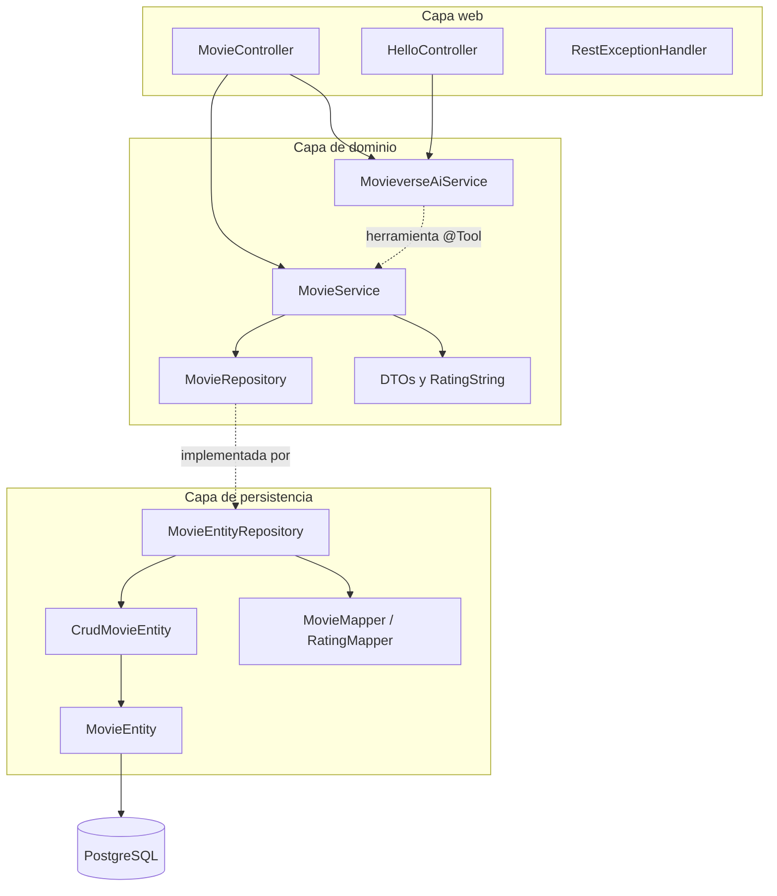
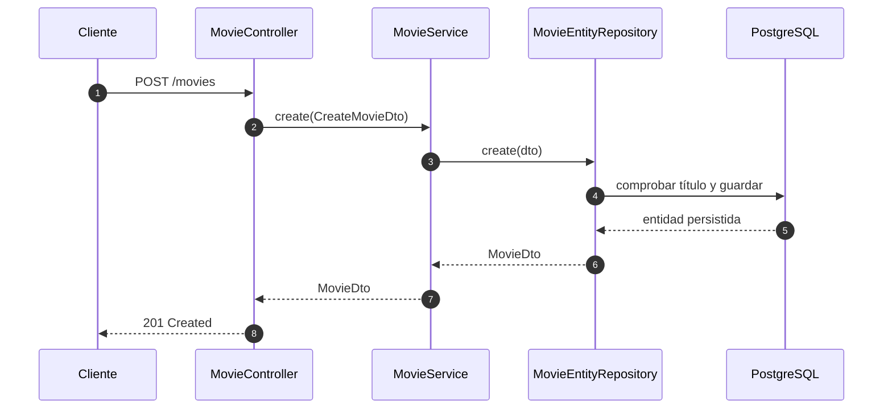
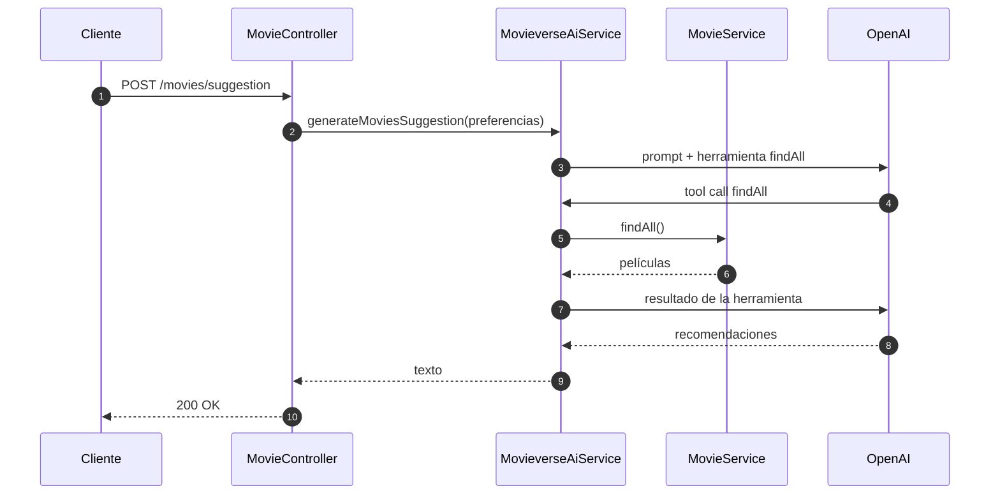

# Arquitectura — Movieverse API

Documento técnico de la API. Para instalación, ejecución y configuración, consulta el [README.md](README.md). Instrucciones para agentes: [AGENTS.md](AGENTS.md).

## Principios

- **Arquitectura hexagonal:** el dominio define contratos y la persistencia los implementa.
- **Separación de capas:** `web` gestiona HTTP, `domain` contiene servicios y contratos, `persistence` implementa el acceso a datos.
- **Dominio independiente:** `domain/` no debe importar clases de `persistence/` ni de `web/`.
- **DTOs como `record`:** los contratos de entrada y salida son inmutables.
- **Mapeo con MapStruct:** las entidades JPA no se exponen directamente en la API.

## Vista de capas



## Estructura de paquetes

```text
src/main/java/com/afperdomo2/movieverse/
├── MovieverseApplication.java
├── config/
│   └── AiHttpConfig.java
├── domain/
│   ├── RatingString.java
│   ├── dto/
│   │   ├── CreateMovieDto.java
│   │   ├── MovieDto.java
│   │   ├── SuggestionRequestDto.java
│   │   └── UpdateMovieDto.java
│   ├── exception/
│   │   ├── MovieAlreadyExistsException.java
│   │   └── MovieNotFoundException.java
│   ├── repository/
│   │   └── MovieRepository.java
│   └── service/
│       ├── MovieService.java
│       └── MovieverseAiService.java
├── persistence/
│   ├── crud/CrudMovieEntity.java
│   ├── entity/MovieEntity.java
│   ├── mapper/
│   │   ├── MovieMapper.java
│   │   └── RatingMapper.java
│   └── repository/MovieEntityRepository.java
└── web/
    ├── controller/
    │   ├── HelloController.java
    │   └── MovieController.java
    └── exception/
        ├── Error.java
        └── RestExceptionHandler.java
```

## Flujo de una petición CRUD



`MovieService` depende de la interfaz `MovieRepository`; Spring inyecta `MovieEntityRepository`, que es la implementación de persistencia.

### Paginación del listado

`GET /movies?page=1&limit=10` usa `PageQuery` (page 1-based, limit entre 1 y 100) y llama a `MovieService.findPage`, que delega en `MovieEntityRepository.findPage`. Este construye `PageRequest.of(page - 1, limit, Sort.by("id").ascending())` y devuelve un `PageResponse<MovieDto>` con `items`, `totalElements`, `totalPages`, `hasNext` y `hasPrevious`.

- Una página fuera de rango devuelve `items` vacío con HTTP 200.
- Parámetros inválidos devuelven HTTP 400.
- `MovieService.findAll()` se mantiene sin paginar porque es la herramienta `@Tool` que usa la IA.

## Componentes principales

| Componente | Responsabilidad |
|---|---|
| `MovieController` | Expone `/movies`, valida la entrada y traduce a códigos HTTP |
| `HelloController` | Expone `/hello` para probar la integración con IA |
| `MovieService` | Orquesta las operaciones de negocio y expone `findAll` como herramienta de IA |
| `MovieRepository` | Contrato de persistencia del dominio |
| `MovieEntityRepository` | Implementa el contrato usando `CrudMovieEntity` y MapStruct |
| `CrudMovieEntity` | Repositorio Spring Data (`JpaRepository`) |
| `MovieMapper` | Convierte entre `MovieEntity` y DTOs |
| `RatingMapper` | Calcula `ratingString` a partir del rating numérico |
| `RestExceptionHandler` | Traduce excepciones de dominio a respuestas HTTP |
| `MovieverseAiService` | Clase `@Service` que encapsula un `ChatClient` de Spring AI |
| `AiHttpConfig` | Añade `x-opencode-session` y user agent cuando el base-url es de OpenCode Go |

## Modelo de dominio

| DTO | Uso |
|---|---|
| `MovieDto` | Respuesta completa de una película |
| `CreateMovieDto` | Entrada para crear; incluye validaciones |
| `UpdateMovieDto` | Entrada para actualizar título, fecha y rating |
| `PatchMovieDto` | Entrada para actualizar parcialmente título, fecha y rating; usa `Optional` |
| `PageQuery` | Parámetros de paginación `page` (1-based) y `limit` (máximo 100) |
| `PageResponse<T>` | Respuesta paginada con `items`, página actual y metadatos |
| `SuggestionRequestDto` | Preferencias del usuario para generar sugerencias |

### Validaciones de creación

- `title`: obligatorio.
- `duration`: obligatorio y mayor que 0.
- `genre`: obligatorio.
- `releaseDate`: obligatorio y no futuro.
- `rating`: obligatorio, entre 0 y 9.

### Categorías de rating

`RatingMapper` calcula `ratingString` con `floor(rating / 2)`:

| Rango numérico | `RatingString` |
|---|---|
| `>= 8.0` | `VERY_GOOD` |
| `6.0 – 7.99` | `GOOD` |
| `4.0 – 5.99` | `AVERAGE` |
| `2.0 – 3.99` | `BAD` |
| `< 2.0` | `VERY_BAD` |

## Persistencia

La entidad `MovieEntity` se mapea a la tabla `movies`:

| Campo | Tipo | Observación |
|---|---|---|
| `id` | `BIGINT` | Autoincremental |
| `title` | `VARCHAR` | Único y obligatorio |
| `duration` | `INTEGER` | Minutos |
| `genre` | `VARCHAR(50)` | Obligatorio |
| `release_date` | `DATE` | Obligatorio |
| `rating` | `DECIMAL(3,2)` | Puede ser nulo |
| `status` | `VARCHAR(1)` | `A` en datos iniciales; `D` al crear desde la API |
| `version` | `BIGINT` | Bloqueo optimista (`@Version`), por defecto `0` |
| `created_at` | `TIMESTAMP WITH TIME ZONE` | Auditoría, no se modifica tras crear |
| `updated_at` | `TIMESTAMP WITH TIME ZONE` | Auditoría, se actualiza en cada cambio |

Reglas relevantes:

- La auditoría usa Spring Data JPA (`@CreatedDate`/`@LastModifiedDate` + `@EnableJpaAuditing`). Las columnas son `NOT NULL DEFAULT now()` para que `ddl-auto=update` pueda añadirlas sobre tablas con datos.
- `version` implementa bloqueo optimista: Hibernate lo incrementa en cada actualización y lanza `OptimisticLockException` si hay conflicto.
- La entidad usa Lombok (`@Getter`, `@Setter`, `@NoArgsConstructor`); no se usa `@Data` para evitar `equals`/`hashCode`/`toString` inadecuados en JPA.
- `create` fuerza `status = "D"` sin importar el valor enviado.
- `update` (PUT) actualiza título, fecha y rating; los campos omitidos se guardan como `null`.
- `patch` (PATCH) usa `PatchMovieDto` con `Optional` y solo modifica los campos presentes. Un body vacío devuelve 400; un título duplicado devuelve 409; la operación es `@Transactional`.
- Un título duplicado lanza `MovieAlreadyExistsException` → HTTP 409.
- Un ID inexistente lanza `MovieNotFoundException` → HTTP 404.
- `data.sql` inserta películas de ejemplo solo si la tabla está vacía.
- El perfil `dev` usa `spring.jpa.hibernate.ddl-auto=update`; no hay migraciones versionadas.

MapStruct genera las implementaciones al compilar. Si se cambia un mapper y el comportamiento no se actualiza, ejecuta `clean` antes de recompilar.

## Integración con IA

`MovieverseAiService` es una clase `@Service` que construye un `ChatClient` a partir del `ChatClient.Builder` que autoconfigura Spring AI. `MovieService.findAll` está anotado con `@Tool` y se registra en la petición de sugerencias con `.tools(movieService)`, de modo que el modelo puede consultar las películas disponibles.

El base-url y el modelo se resuelven con `OPENAI_BASE_URL` y `OPENAI_MODEL` (por defecto OpenAI y `gpt-4o-mini`). Si el base-url apunta a `opencode.ai`, `AiHttpConfig` añade las cabeceras `x-opencode-session` y `User-Agent` que exige OpenCode Go.



La clave por defecto es `demo`. Los endpoints de IA requieren una clave real en `OPENAI_API_KEY`; el CRUD no depende de la IA.

## Configuración y perfiles

| Perfil | Puerto | Base de datos | Observaciones |
|---|---|---|---|
| `dev` | `8082` | PostgreSQL local en `5434` | `ddl-auto=update`, `data.sql` activo |
| `prod` | `8080` | Base externa | Perfil usado por el contenedor Docker |

La configuración base (`application.properties`) define el puerto `8081`, pero `application-dev.properties` lo sobrescribe a `8082`.

Para producción, configura las credenciales mediante variables de entorno. El archivo `application-prod.properties` contiene configuración de una base externa; no lo uses en local sin revisar esos valores.

## Cómo extender el CRUD

Para añadir un campo o una operación:

1. Actualiza el DTO correspondiente en `domain/dto`.
2. Modifica la interfaz `domain/repository/MovieRepository`.
3. Implementa el cambio en `persistence/repository/MovieEntityRepository`.
4. Ajusta `persistence/mapper/MovieMapper` si cambian los campos.
5. Expón la operación en `web/controller/MovieController`.
6. Ejecuta `.\gradlew.bat build` con PostgreSQL levantado.

## Limitaciones conocidas

- Solo existe un test de contexto (`contextLoads`); no hay tests unitarios ni de integración por caso de uso.
- No hay Flyway/Liquibase: el esquema se actualiza con `ddl-auto=update`.
- El perfil `prod` tiene configuración sensible embebida; debería migrarse a variables de entorno.
- Los endpoints de IA no funcionan con la clave de demo.
- `docker-compose.yaml` solo levanta PostgreSQL, no la aplicación.
- MapStruct advierte que `updateEntityFromDto` no mapea `id`, `duration`, `genre` y `status`; es intencional, pero se puede silenciar con `ignore = true`.
